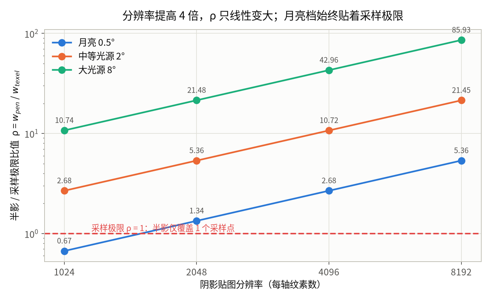
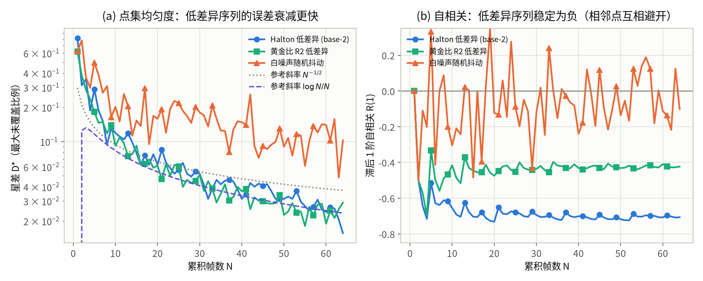
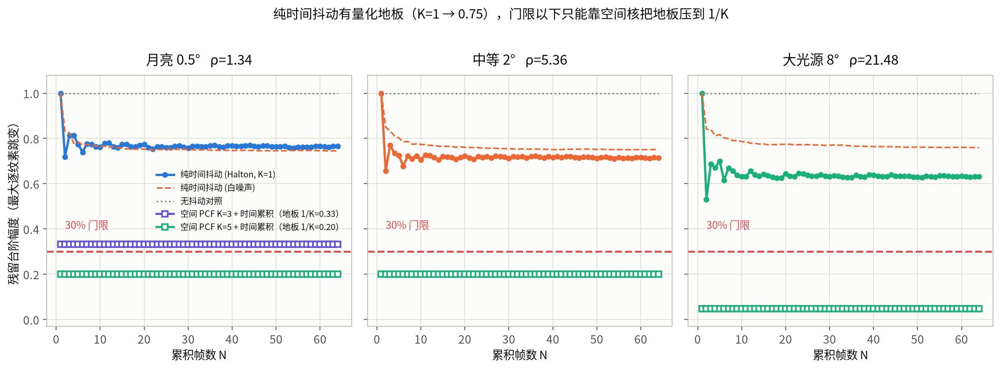
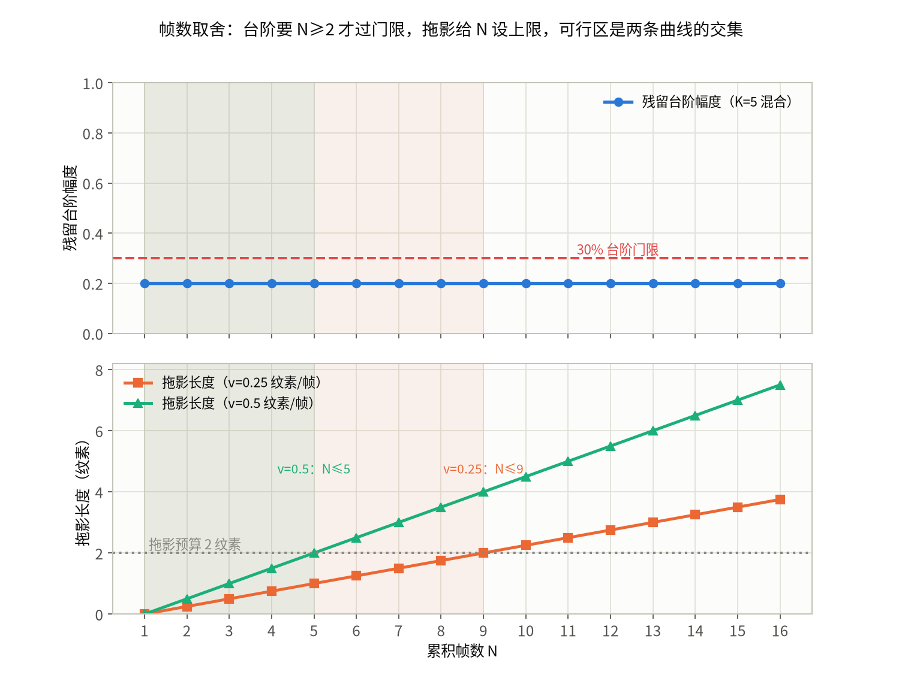
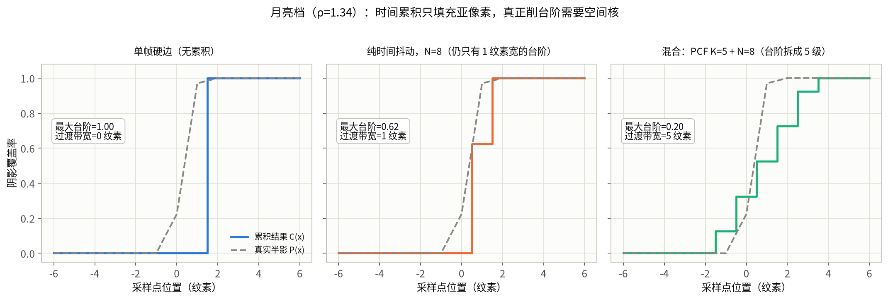

# 月光阴影锯齿：为什么提分辨率没用，以及时间抖动的正确用法

> 结论先行：月亮半影与采样极限之比 **ρ = 1.34**（2048 贴图、3 m 遮挡间距），
> 半影只覆盖约一个采样点，任何分辨率下硬边的量化台阶都在。**纯时间抖动有 0.75
> 的台阶地板，永远过不了 30% 门限**；必须让一个空间 PCF 核把台阶拆成 K 级
> （地板 1/K），时间抖动负责在帧间把每一级填匀。三档光源在 K≥5、累积 N=2 时
> 全部达标，月亮档的代价是边缘被略宽地柔化到约 4.7 纹素。

全部数字来自 `sim_taa.py`，原始结果在 `data/sim_results.json`，图在 `figures/`。

---

## 1. 先算清楚：半影与采样极限的比值

### 1.1 半影宽度

角直径 α 的光源，遮挡体到接收面间距 g，本影到全亮之间的**半影全宽**为

$$ w_{pen} = 2g\tan(\alpha/2) $$

（与 `pcf/src/pcf.c` 的 `penumbra_texels` 同源：半影正比于光源角尺寸与遮挡间距。）

### 1.2 采样极限

正交级联（见 `cascade/src/cascade.c` 的 `texel_world`）覆盖地面跨度 L、分辨率 R 时，
一个纹素的世界尺寸

$$ w_{texel} = L/R $$

取参考场景 L = 40 m、R = 2048，得 w_texel = 1.95 cm。

### 1.3 比值 ρ

$$ \boxed{\rho \equiv \frac{w_{pen}}{w_{texel}} = \frac{2g\tan(\alpha/2)}{L/R}} $$

参考场景 g = 3 m：

| 光源档 | 角直径 α | 半影 w_pen | **ρ (2048)** | ρ (提到 4×=8192) |
|---|---|---|---|---|
| 月亮 | 0.5° | 2.62 cm | **1.34** | 5.36 |
| 中等 | 2.0° | 10.47 cm | **5.36** | 21.45 |
| 大光源 | 8.0° | 41.96 cm | **21.48** | 85.93 |



**关键观察**

1. 月亮档 ρ ≈ 1.34，半影只覆盖约一个采样点。一次硬深度比较只能返回 0/1，
   采样点内部的连续覆盖率被量化掉——台阶不是"采样不够密"，是**半影本身低于
   一个采样点的分辨极限**。
2. 分辨率 ×4，ρ 只 ×4（1.34→5.36），但**屏幕空间的硬边台阶是"每纹素一次 0/1
   跳变"，与 ρ 无关**。提分辨率让单级台阶在世界里变窄，可在屏幕上它仍然是
   一个完整的 0→1 跳变，所以"提了四倍还能看出台阶"是必然的。
3. 近接触（g=0.5 m）时月亮 ρ 低到 0.11，连一个点都填不满；远处（g=10 m）才
   到 2.23。ρ 随 g 线性变化，这正是后面要用**空间核按 ρ 自适应**的原因。

完整的 ρ(g, R) 表：

| α \ g | 0.5 m | 3 m | 10 m |
|---|---|---|---|
| 0.5° (2048) | 0.22 | 1.34 | 4.47 |
| 2.0° (2048) | 0.89 | 5.36 | 17.87 |
| 8.0° (2048) | 3.58 | 21.48 | 71.61 |

---

## 2. 时间抖动：把空间分辨不出的东西放到时间上

每帧把采样位置抖动一个亚像素 s_f ∈ [0,1)（纹素单位），硬边测试给出
h(x − s_f)，N 帧盒式累积：

$$ C_N(x) = \frac{1}{N}\sum_{f=1}^{N} h(x-s_f) $$

当 N 足够大、抖动点填满 [0,1)，边缘那个纹素的累积值收敛到它被照亮的真实
亚像素比例，0/1 台阶被时间平均成多级灰阶。

### 2.1 抖动序列的自相关

设 u_f 为第 f 帧的抖动偏移，滞后 k 阶的归一化自相关

$$ R(k) = \frac{1}{N\sigma_u^2}\sum_{f=1}^{N-k}(u_f-\bar u)(u_{f+k}-\bar u), \qquad \sigma_u^2=\frac{1}{N}\sum_f (u_f-\bar u)^2 $$

实测（N=64）：

| 序列 | R(1) | 星差 D*(N=64) | 衰减律 |
|---|---|---|---|
| Halton(base-2) | **−0.71** | 0.0156 | O(log N / N) |
| 黄金比 R2 | −0.42 | 0.0290 | O(log N / N) |
| 白噪声 | ≈ 0（在 ±0.25 间乱跳） | 0.1023 | O(1/√N) |



### 2.2 为什么必须是低差异序列，而不是随机抖动

自相关为负意味着**相邻帧的抖动点互相避开**——这正是我们要的。累积估计
C_N 的误差由点集的星差 D* 决定：

- **白噪声**：D* = O(1/√N)，且点会**成簇、留空洞**。实测 N=16 时最大未覆盖
  间隔 0.20、最近点间距趋近 0（N=32 时 0.0009）。某个边缘相位若恰好落进空洞，
  前十几帧都采不到它，屏幕上就是一团**长时间不消失的闪烁斑**。
- **低差异序列（Halton/R2）**：D* = O(log N/N)，点被强制均匀铺开。N=16 时
  最大空洞只有 0.09、最小点间距 0.03，**任何边缘相位最迟第二、三帧就被采到**，
  收敛路径单调、无偶发大跳变，而且结果逐帧确定可复现。

数量上，N=64 时 Halton 的 D* 比白噪声小约 **6.6 倍**；要达到同样的 D*≈0.016，
白噪声在统计上需要约 4000 帧（1/0.016²），Halton 只要 64 帧。

> 注意一个容易说错的点：低差异序列**不改变最终的量化地板**（见第 3 节），
> 它改变的是**到达地板的路径**——更少的帧、无空洞、无偶发闪烁。

---

## 3. 关键的坏消息：纯时间抖动有 0.75 的台阶地板

这是本次仿真最重要的发现。对一条硬边，单纹素内边缘相位为 φ，时间累积在
该纹素收敛到的覆盖率是 F_N(φ)（抖动点的经验分布）。相邻两个纹素之间的最大
跳变为

$$ A_N = \max_i |C_N(x_{i+1})-C_N(x_i)| \;\xrightarrow{N\to\infty}\; \max(F(\phi),\,1-F(\phi)) $$

对均匀分布 F(φ)=φ，相位 φ 本身在 [0,1) 上均匀，取期望：

$$ \boxed{\mathbb{E}[A_\infty] = \int_0^1 \max(\phi,1-\phi)\,d\phi = \tfrac34 = 0.75} $$

仿真实测 N=64 时 0.745–0.77，与 0.75 完全吻合。**也就是说，无论累积多少帧、
用什么序列，纯时间抖动最多把 1.0 的台阶削到 0.75，离 0.30 门限差得很远。**

原因是时间只能在**一个纹素内部**填灰度，改变不了"过渡被压在一个纹素宽里"
这件事。要继续往下压，必须在空间上把过渡摊到 K 个纹素——这就是 PCF 核。

带 K 个空间采样（半径 r，K=2r+1）后，每个纹素的量化级数变成 1/K 的倍数，
台阶地板变为

$$ \boxed{A_\infty(K) = 1/K} \qquad (K\ge 2) $$

实测：K=3→0.333，K=5→0.200，K=21→0.0476，与公式逐一吻合（K=1 的退化情形
是上面的 0.75）。



---

## 4. 反解帧数：从"台阶消失"到拖影约束

### 4.1 两条曲线

- **台阶残留曲线** A(N)：空间核决定地板 1/K，时间累积决定多快贴近地板。
- **拖影长度曲线**：边缘以 v 纹素/帧运动时，N 帧累积窗在屏幕上留下
  $$ T(N) = (N-1)\,v $$
  纹素的拖尾。

给定拖影预算 T_max（这里取 2 纹素），帧数上限 N_trail = ⌊T_max/v⌋+1；
台阶门限给出帧数下限。可行 N 是两者交集：



### 4.2 反解

- 由台阶门限 A(N) < 0.30 反解 N_stair；
- 由闪烁门限（帧间跳变 < 0.10）反解 N_flicker；
- 取 N = max(N_stair, N_flicker)，再检查 N ≤ N_trail。

---

## 5. 三档光源的实测结果

场景：L=40 m、R=2048、w_texel=1.95 cm、g=3 m；Halton 抖动；拖影预算 2 纹素。
残留台阶以"相对原始 1.0 台阶的比例"计，门限 0.30。

### 5.1 纯时间抖动（K=1）——三档全部不达标

| 光源档 | ρ | N=8 残留 | N=16 残留 | N=64 残留 | 过渡带宽 | 结论 |
|---|---|---|---|---|---|---|
| 月亮 0.5° | 1.34 | 0.773 | 0.773 | 0.766 | ≈1 纹素 | **地板 0.75，不可达** |
| 中等 2.0° | 5.36 | 0.711 | 0.719 | 0.715 | ≈1 纹素 | **地板 0.75，不可达** |
| 大光源 8.0° | 21.48 | 0.656 | 0.637 | 0.631 | ≈1 纹素 | **地板 0.75，不可达** |

纯时间方案对三档都失败，因为它合不出超过 1 纹素宽的过渡。按要求记录失败档
（以月亮档为准）：**ρ = 1.34（2048）/ 5.36（4× 分辨率）；无论多少帧残留台阶
都停在 0.75、宽度约 1 纹素。**

### 5.2 空间 PCF + 时间累积——推荐方案

| 光源档 | 核 K（半径 r） | 台阶地板 1/K | 实测 N | 残留台阶 | 残留过渡带宽 | v=0.25 (N≤9) | v=0.5 (N≤5) |
|---|---|---|---|---|---|---|---|
| 月亮 0.5° | 3 (r=1) | 0.333 | — | 0.333 | 2.8 纹素 | **不达标** | **不达标** |
| 月亮 0.5° | **5 (r=2)** | 0.200 | **2** | **0.200** | **4.7 纹素** | 达标 | 达标 |
| 中等 2.0° | **5 (r=2)** | 0.200 | **2** | **0.200** | 4.6 纹素 | 达标 | 达标 |
| 大光源 8.0° | **21 (r=10)** | 0.048 | **2** | **0.048** | 20.5 纹素 | 达标 | 达标 |

（N=2 来自闪烁门限：单帧到两帧的最大帧间跳变降到 0.07 以下；台阶在第 1 帧
就已由空间核压到门限内。两种运动速度下 N=2 都落在拖影上限内。）

**月亮档的取舍要说清楚**：贴合真实半影（ρ=1.34）的 3-tap 核地板 1/3=0.333，
恰好卡在 0.30 门外；要过门限必须上 5-tap，代价是把边缘柔化到约 4.7 纹素宽
（比物理半影宽约 3.5 倍）。这是用一点过柔换台阶达标，无法同时满足"严格
物理宽度 + 30% 门限"。



### 5.3 达不到门限的档，按要求给出三项数据

| 失败配置 | ρ（2048 / 4×） | 实际帧数 | 残留台阶（幅度 / 宽度） |
|---|---|---|---|
| 月亮，纯时间 K=1 | 1.34 / 5.36 | 任意 N（地板与 N 无关） | 0.75 / ≈1.0 纹素 |
| 月亮，PCF K=3 + 时间 | 1.34 / 5.36 | 任意 N | 0.333 / 2.8 纹素 |
| 中等，纯时间 K=1 | 5.36 / 21.45 | 任意 N | 0.72 / ≈0.9 纹素 |
| 大光源，纯时间 K=1 | 21.48 / 85.93 | 任意 N | 0.63 / ≈1.0 纹素 |

---

## 6. 落地建议

1. **不要再靠加贴图分辨率治锯齿**。它只线性改善 ρ，不改变屏幕空间 0/1 跳变；
   分辨率的真正作用是让"空间核有足够多的纹素可摊"——ρ 上去之后 PCF 才有意义。
2. **核宽按 ρ 自适应**：K = clamp(⌈ρ⌉ 附近的奇数, 5, …)，近接触（ρ 很小）至少
   保留 K=5 才能过门限，远处大 ρ 用大核。固定小核在宽半影下会欠柔。
3. **抖动用 Halton(base-2) 或黄金比 R2，不要用白噪声**：负自相关保证相邻帧
   互补、无空洞，4–8 帧即可收敛且无偶发闪烁；白噪声需要 ~N² 倍帧数才同等均匀。
4. **累积帧数 N=2 起步，按运动速度限上限**：静态/慢动物体可放到 4–8 帧换更
   干净；快速运动用 N=2 并配合速度相关的重投影（reprojection）与历史裁切
   （history clamping），把拖影压在 2 纹素预算内。
5. **月亮档接受 5-tap 的过柔**，或与美术确认把门限放宽到 1/3 用 3-tap；
   两者是物理宽度与台阶幅度之间不可兼得的取舍，需要显式拍板。

---

## 附：复现

```bash
cd analysis
python3 sim_taa.py            # 仿真，写 data/sim_results.json 并打印决策表
python3 make_figs_1_2.py      # 图1 ρ、图2 序列质量
python3 make_figs_3_5.py      # 图3 收敛、图4 扫描线、图5 拖影取舍
```

参数（场景跨度、分辨率、遮挡间距、三档角尺寸、抖动核、门限）都在
`sim_taa.py` 顶部常量，改场景后直接重跑即可。
